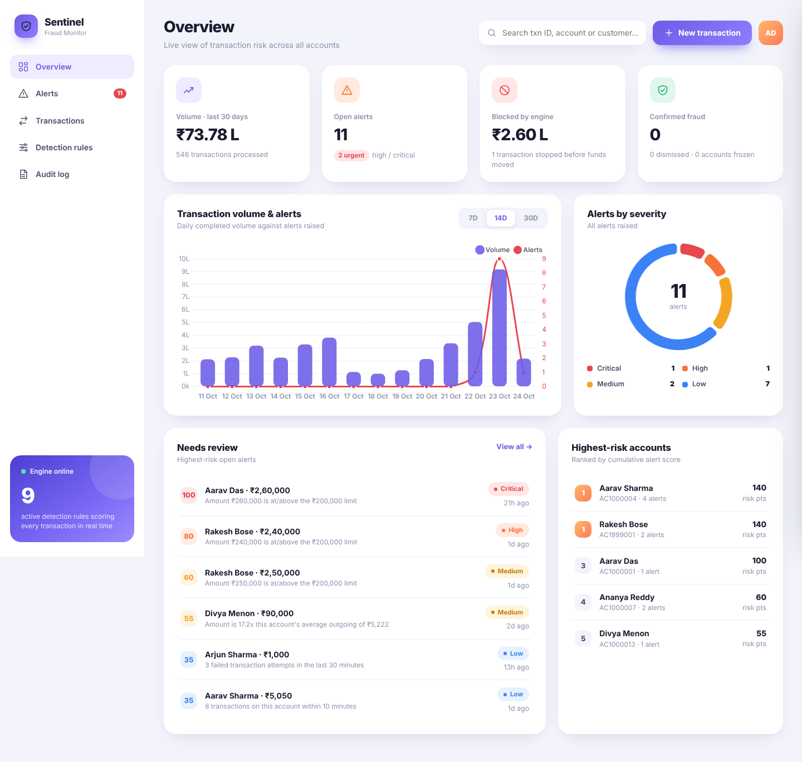
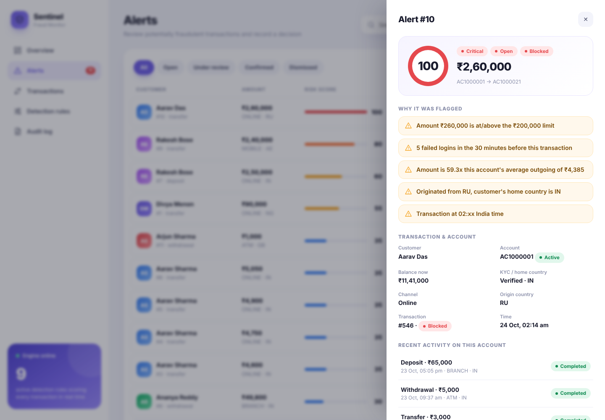
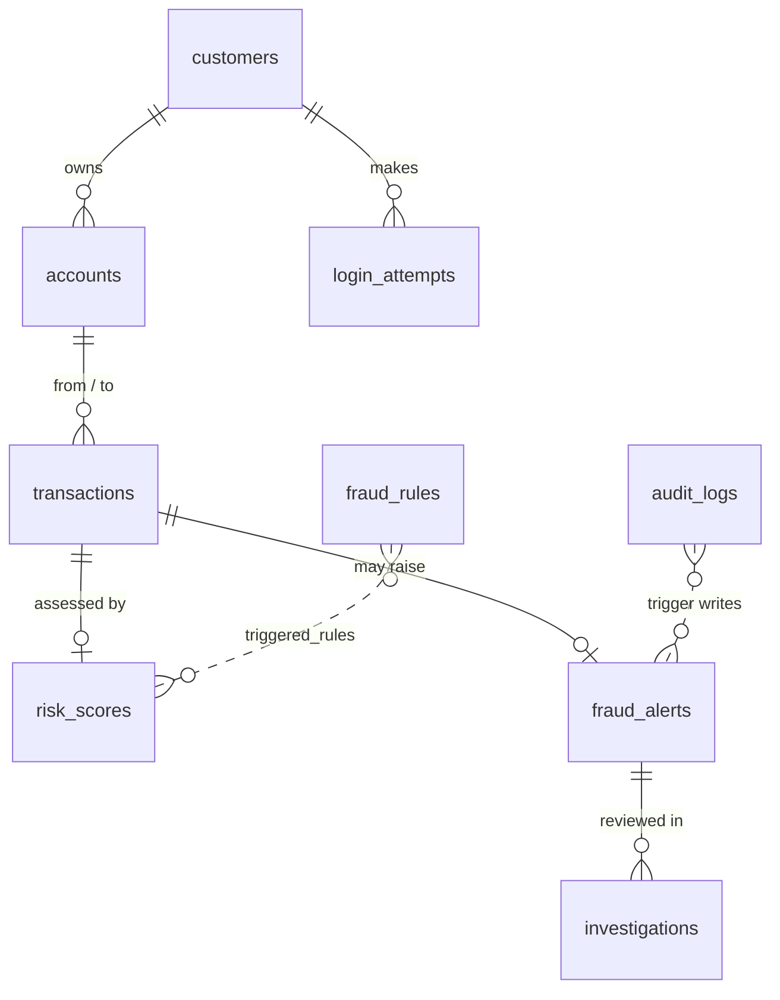

# Financial Transaction Monitoring and Fraud Detection System Using PostgreSQL

A database-driven system that records financial transactions, scores each one against configurable
fraud rules, raises explainable alerts, and gives analysts a dashboard to review and decide.

> **Abstract.** The project develops a database-driven financial transaction monitoring system that identifies
> potentially suspicious activities using configurable detection rules, risk scoring, and transaction pattern
> analysis. It incorporates relational database design, transaction management, concurrency control, indexing,
> audit logging, and advanced SQL queries to maintain data integrity and support efficient investigation of
> suspicious transactions.

| Overview | Alert detail |
|---|---|
|  |  |

More screens in `docs/screenshots/` (alerts, transactions, rules, audit log).

---

## Quick start

Requirements: **PostgreSQL 14+**, **Python 3.10+**.

```bash
# 1. create an empty database
createdb fraud_monitor                      # or: psql -U postgres -c "CREATE DATABASE fraud_monitor"

# 2. install dependencies
pip install -r requirements.txt

# 3. tell the app how to connect (adjust user/password)
export DATABASE_URL="dbname=fraud_monitor user=postgres password=YOURPASS host=localhost"
#   Windows PowerShell:  $env:DATABASE_URL="dbname=fraud_monitor user=postgres password=YOURPASS host=localhost"

# 4. build schema + rules + ~30 days of demo data (with planted fraud scenarios)
python seed.py

# 5. run the dashboard
python app/app.py                           # open http://localhost:5000
```

`./run.sh` does steps 2-5 on Linux/macOS. Everything (including Chart.js) is bundled — no internet needed.

**Prove the concurrency control:** `python tests/concurrency_test.py` (uses a throw-away database).
**Advanced SQL + EXPLAIN ANALYZE:** `psql fraud_monitor -f db/queries.sql`

---

## Architecture

```
Browser dashboard (HTML/CSS/JS + Chart.js)
        │  REST/JSON
Flask API  app/app.py ──► engine.py  (rule scoring + ACID transaction processing)
        │  psycopg2
PostgreSQL  db/schema.sql  (9 tables, constraints, indexes, triggers, views)
```

## Database design (9 tables)



| Table | Purpose |
|---|---|
| `customers` | Customer details, home country, KYC status |
| `accounts` | Account number, balance (`CHECK balance >= 0`), status ACTIVE / FROZEN / CLOSED |
| `transactions` | Deposits, withdrawals, transfers; status COMPLETED / FLAGGED / BLOCKED / FAILED |
| `fraud_rules` | Configurable rules: threshold, time window, weight, on/off |
| `fraud_alerts` | One alert per suspicious transaction: score, severity, human-readable reasons, review status |
| `risk_scores` | Risk assessment of **every** transaction, with the list of rules that fired |
| `investigations` | Analyst decisions and notes (the trail behind each alert) |
| `audit_logs` | Who changed what and when (trigger-written + rule edits) |
| `login_attempts` | Successful and failed logins (feeds the failed-login rule) |

## DBMS concepts demonstrated (and where)

| Concept | Where to look |
|---|---|
| **ACID transactions** | `engine.execute_transaction()` — ledger row, both balance updates, risk score and alert commit together or not at all |
| **Concurrency control** | `SELECT … FOR UPDATE` on both accounts in a fixed `account_id` order (no double-spend, no deadlock). Proven by `tests/concurrency_test.py`: 10 simultaneous ₹400 withdrawals from ₹1,000 → exactly 2 succeed, balance ends at ₹200 |
| **Constraints** | `CHECK` for amounts/balance/status, `chk_txn_shape` forces each transaction type to have the right from/to accounts, FKs with `RESTRICT`, `UNIQUE` |
| **Triggers** | `trg_audit_alert`, `trg_audit_account` write audit rows on status changes; `trg_block_txn_delete` makes the ledger append-only |
| **Indexes** | Composite `(account, time DESC)`, time, status, and a **partial index** for the open-alert queue — see `EXPLAIN ANALYZE` at the end of `db/queries.sql` |
| **Advanced SQL** | `db/queries.sql`: window functions (rolling 10-minute `RANGE` count, running average, `RANK`), CTEs, `FILTER`, `LATERAL unnest`, subqueries, `HAVING`, views |
| **Views** | `v_alert_details`, `v_daily_summary` |

## Fraud detection rules

Every active rule that fires adds its **weight**; the score is capped at 100. Each rule also adds a plain-English
reason so an analyst sees exactly *why* the transaction was flagged. All values are editable on the **Detection rules** page.

| Rule | Fires when | Default |
|---|---|---|
| `LARGE_AMOUNT` | amount ≥ threshold | ₹2,00,000 · +35 |
| `HIGH_VELOCITY` | ≥ N transactions on the account in the window | 5 in 10 min · +35 |
| `FAILED_LOGINS` | ≥ N failed logins before the transaction | 3 in 30 min · +20 |
| `FAILED_TXNS` | ≥ N failed attempts (e.g. insufficient funds) | 2 in 30 min · +15 |
| `AMOUNT_SPIKE` | outgoing amount > N× the account's 30-day outgoing average | 10× · +25 |
| `STRUCTURING` | ≥ 2 amounts at 90-100% of the reporting limit within 24 h | ₹50,000 · +30 |
| `FOREIGN_COUNTRY` | origin country ≠ customer's home country | +20 |
| `ODD_HOURS` | between 00:00 and 05:00 India time | +10 |
| `NEW_ACCOUNT_LARGE` | large amount on an account younger than the window | ₹1,00,000 / 7 days · +25 |

**Score → action:** ≥ 30 raises an alert (Low 30-49, Medium 50-69, High 70-89, Critical 90+) and marks the transaction
`FLAGGED`; ≥ 90 marks it `BLOCKED` and **funds are not moved**. Analysts mark alerts *Under review*, *Dismissed*, or
*Confirmed* (which freezes the originating account). Thresholds live in `app/engine.py` (`ALERT_THRESHOLD`, `BLOCK_THRESHOLD`).

### Demo data (`seed.py`)

36 customers + 1 new customer, ~560 transactions, plus planted scenarios the engine really catches:
velocity burst, structuring under ₹50,000, account takeover (failed logins → ₹2.6 L from RU at 2 AM → **blocked**),
mule account (large deposit then immediate foreign transfer), probing with failed withdrawals, and an out-of-pattern foreign spike.
Several older alerts are pre-resolved so the review history is populated.

## API

| Endpoint | Purpose |
|---|---|
| `GET /api/summary`, `/api/trends`, `/api/severity`, `/api/top-accounts` | Dashboard numbers and charts |
| `GET /api/alerts`, `/api/alerts/<id>` · `POST /api/alerts/<id>/review` | Alert queue, detail, analyst decision |
| `GET /api/transactions` (filters: `q,type,status,min,max,page`) · `POST /api/transactions` | Ledger search; create a transaction (runs the full engine) |
| `GET /api/rules` · `PUT /api/rules/<id>` | View / edit rules (edits are audited) |
| `GET /api/audit`, `/api/accounts` · `POST /api/login-attempts` | Audit log, account list, record a login attempt |

## Limitations (please state these in your report)

* Alerts are **potential** fraud, not proof — rules are heuristics and will produce false positives (and miss novel patterns). The system is built for human review, which is why every alert carries its reasons and an analyst decision trail.
* Rule-based only; no machine learning. Possible extensions: per-customer behavioural baselines, device/IP fingerprints, graph analysis of transfer rings, a case-management queue with SLAs.
* Demo authentication is omitted: the dashboard assumes a trusted admin. A production system needs login, roles, and HTTPS.
* Single-currency (INR) and a simple ledger (no holds, fees or reversals).

## Project layout

```
db/schema.sql      tables, constraints, indexes, triggers, views
db/rules.sql       default fraud rules
db/queries.sql     advanced SQL + EXPLAIN ANALYZE
app/engine.py      scoring engine + ACID transaction processing
app/app.py         Flask REST API
app/static/        dashboard (index.html, style.css, app.js, chart.umd.js)
seed.py            schema + rules + demo data
tests/concurrency_test.py
```
